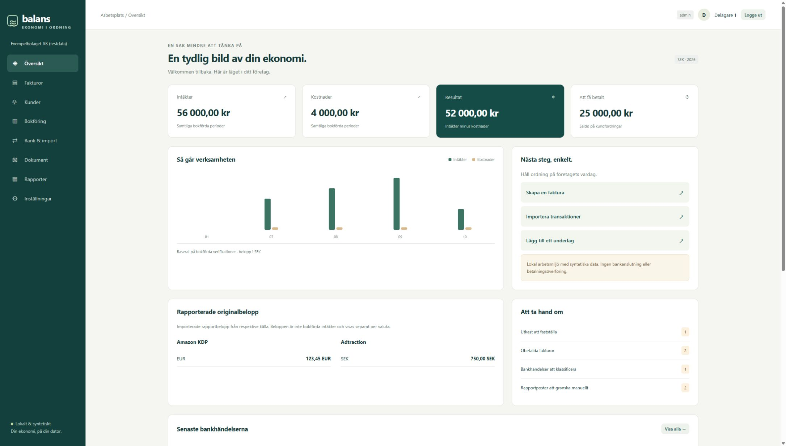

# Balans – lokalt ekonomisystem

En körbar svensk webbapplikation för **syntetiska uppgifter i ett företag**. Riktig SQLite-databas, individuell inloggning, servervaliderad bokföring och ett responsivt gränssnitt. Första lokala versionen av Fas 1 med delar av Fas 2 och tekniska kontroller från Fas 3. Inte färdig för skarp bokföring eller extern drift.



## Starta

Kräver **Node.js 24 eller senare**, med `node:sqlite`. Inga npm-paket behöver installeras.

```powershell
# Endast vid första initieringen i en ny projektkopia:
node scripts/setup.mjs
# Valfritt, endast i en tom initierad databas:
node scripts/demo.mjs
# Starta lokalt:
node src/server.mjs
```

Öppna **http://127.0.0.1:3210**. Använd 127.0.0.1; Host-kontrollen avvisar localhost och externa värdar. Servern lyssnar enbart på loopback.

Två individuella konton skapas: `delagare1@example.test` och `delagare2@example.test`. Setup genererar slumpade lösenord och skriver dem till terminalen. I den första arbetskopian är setup redan körd och uppgifterna finns i **`data/initial-login.txt`**, som ignoreras av Git. Spara dem i din lösenordshanterare och radera textfilen när den inte behövs. Lösenord lagras som scrypt-hashar i databasen.

Data lagras i `data/ekonomi.sqlite`. Starta om processen efter kodändringar. `DATABASE_PATH` och `PORT` kan anges som miljövariabler. `scripts/start.ps1` startar från projektmappen. Använd inte demodatabasen för riktiga uppgifter.

## Prova ett arbetsflöde

1. Skapa en kund med fiktiva uppgifter under **Kunder**.
2. Skapa en faktura: antal `1`, pris `20000`, moms `25 %` och datum inom företagets räkenskapsår. Spara utkastet.
3. Välj **Fastställ**: ett unikt nummer tilldelas atomärt och 25 000 kr bokförs på 1510 mot 20 000 kr på 3041 och 5 000 kr på 2611.
4. Ladda ned PDF, registrera en delbetalning eller kreditera en helt obetald faktura.
5. Kontrollera rapporter, grundbok och behandlingshistorik. En manuell verifikation måste balansera; rättelser skapas som nya motbokningar.
6. Importera en av filerna i `examples/` under **Bank & import**. Anpassa fältmappning vid andra rubriker. Importerade KDP-/Adtraction-rader bokförs inte automatiskt.

Kundbetalningar registreras i fakturaflödet. Bankklassificering mot 1510 är spärrad tills ett gemensamt avstämnings-/matchningsflöde finns; bokför inte samma betalning igen som en fristående verifikation.

## Funktioner och gränser

- Två administratörer, individuella sessioner och serverkontrollerade roller (`admin`, `accountant`, `viewer`). Kontoadministration/lösenordsbyte via UI återstår.
- Företagsinställningar med versionskontroll, kunder och enradiga svenska tjänstefakturor med 25 % moms. Full kredit av helt obetald faktura. Delkredit, kredit av betald faktura, olika leveransdatum och flera fakturarader återstår.
- Begränsad BAS-inspirerad kontoplan, dubbel bokföring, grundbok, verifikationsrader, saldobalans, resultat och balans. Periodlåsning och separata rättelser. Full huvudbok med kontofilter samt flera räkenskapsår/årsavslut återstår.
- Bankregistrering och konfigurerbar CSV-import för bank, KDP och Adtraction. Det är en normaliserad CSV-import, inte verifierade adaptrar för alla leverantörers originalrapporter. Belopp och valuta bevaras; rapportperiod kan mappas. Plattformarnas motpart, skatt och moms kräver manuell bedömning.
- Dubblettkontroll per fil och transaktionsfingeravtryck. Flera identiska ekonomiska rader i samma fil avvisas atomärt med begäran om unika referenser. En legitim ny händelse i en annan fil som har exakt samma identitet går inte att skilja från en dubblett; använd stabila unika källreferenser och granska importerade/dubbla radantal.
- Manuell bankklassificering med explicit granskning och växelkurs till SEK. Ingen betalningsöverföring. Automatisk fakturamatchning, matchning av plattformsutbetalningar och full bankavstämning återstår.
- PDF/PNG/JPEG-underlag upp till 5 MB, innehållskontroll, SHA-256, dokumentversioner och nedladdning. Underlag kopplas vid skapande av en manuell verifikation. Fulltext/OCR, virusgranskning och efterkoppling till redan bokförd post återstår.
- Dashboard med bokförda värden, åtgärder och separata importerade plattformsbelopp per valuta. SIE 4E med CP437 och JSON-export inklusive underlag, fakturasnapshots och full audit. Extern SIE-validator/provimport återstår.

Alla monetära operationer använder heltalsören och BigInt vid multiplikation/avrundning. Originalbelopp är hundradelar av originalvalutan; import stöder högst två decimaler och växelkurser högst sex. Automatisk valutafakturering saknas; valutakursdifferenser kan bokföras manuellt med separata konton 3960/7960. Fakturor och enskilda belopp har en gräns på 10 miljarder kr; all ackumulerad debet är begränsad till 1 000 miljarder kr. Även betalningar och rättelser förbrukar denna senare gräns. Dessa är uttryckliga gränser för den lokala versionen, inte företags- eller kreditgränser.

PDF-fakturor använder latinska tecken, fast radbredd och sidbrytning. Tecken utanför stödd font avvisas för att undvika tyst förvanskning. Leverans-/tjänstedatum antas vara fakturadatum och framgår av PDF:en.

## Testa

```powershell
node --test
node --check public/app.js
```

Testsviten omfattar domänregler, HTTP, samtidiga betalningar/fastställelser, roller/CSRF/Origin/Host, import, SIE och backup/återställning. Oberoende granskare har lagt till egna regressionstester. Se `docs/TESTER.md` för faktiskt genomförda kontroller och begränsningar.

## Backup och återställning

Automatisk lokal backup skapas vid serverstart och var 24:e timme så länge processen kör. Ingen automatisk radering görs. Underlag ligger som BLOB i databasen och ingår. Backup verifieras med integritetskontroll, främmande nycklar, verifikationsbalans och dokumenthashar. En manifestfil med SHA-256 skapas bredvid backupen.

```powershell
node scripts/backup.mjs create
# Stoppa servern. Återställ alltid till en NY sökväg:
node scripts/backup.mjs restore backups/ekonomi-DATUM.sqlite data/aterstalld.sqlite
$env:DATABASE_PATH = 'data/aterstalld.sqlite'
node src/server.mjs
```

Kopiera både `.sqlite` och `.sqlite.json` till en separat skyddad lagringsplats för att skydda mot diskförlust. Lokala backuper är inte en oberoende arkivtjänst. Manifestets hash upptäcker korruption men är inte ett signerat manipulationsskydd. Sessioner tas bort vid återställning. JSON-/SIE-export ersätter inte en fullständig återställningsbar backup.

## Arkitektur, granskning och nästa etapp

- `docs/ARKITEKTUR.md`: modulgränser, datamodell, API och teknikval.
- `docs/REGELVERK.md`: primärkällor, datum, antaganden och extern kontroll.
- `docs/SAKERHET.md`: säkerhetsplan; `docs/GRANSKNING-SAKERHET.md`: observerade fynd och omgranskning.
- `docs/GRANSKNING-KVALITET.md`: oberoende kvalitetsfynd och regressioner.
- `docs/BACKLOGG.md`: prioriterad fortsättning och godkännandekriterier.
- `docs/LEVERANS.md`: faktisk etappleverans och agentansvar.

Node/SQLite och vanlig JavaScript valdes för att kunna starta utan externa beroenden i den tillgängliga Windowsmiljön. Det är ett dokumenterat avsteg från föreslagna Next.js/React/TypeScript/PostgreSQL/Tailwind. Docker-konfiguration och en sådan migrering är inte implementerade. TLS, driftövervakning och skyddad extern backup behövs före extern drift. Direkt åtkomst till databasfilerna innebär administrativ åtkomst; appens skydd är inte avsedda att stoppa datorns ägare från att manipulera filer.

Ingen produktionsdriftsättning, riktig bankanslutning eller användning av verkliga bokföringsuppgifter har genomförts. Extern redovisningsmässig/juridisk kontroll och ägarens uttryckliga godkännande återstår före skarp användning.
