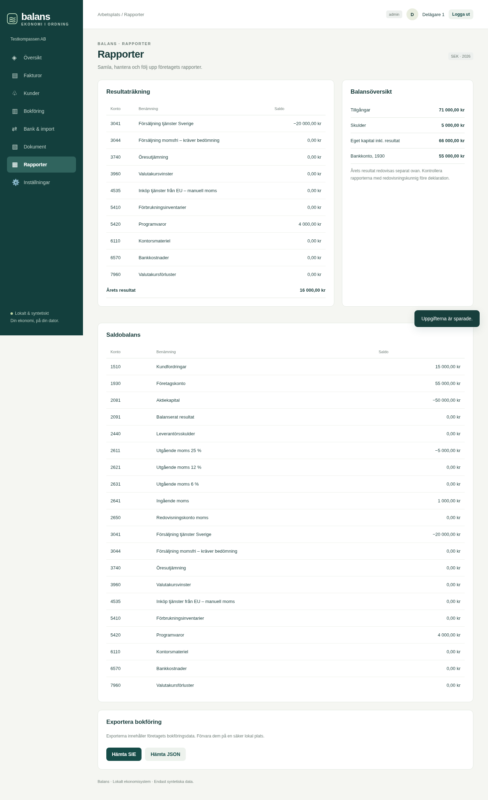

# Testrapport för Balans 0.1.0

**Slutsats.** Enradiga svenska kundfakturor med 25 % moms, delbetalning, full kredit av en obetald faktura och direktbetald kostnad med kvitto fungerade från registrering till bokföring och export i kontrollscenariot. Faktura B och krediten tog ut varandra och alla sex verifikationer balanserade. Bank- och plattformsfiler kunde importeras och en normal lokal säkerhetskopia kunde återställas i en separat databas. Balans bör användas med fiktiva uppgifter tills riskerna nedan har åtgärdats och validerats. [K-01–K-08](#gemensamt-kontrollscenario) · [Import och kostnader](#leverantörer-kostnader-bank-och-import) · [Behörighet och återställning](#behörighet-historik-och-återställning)

**Största risken gäller händelser som bokförs två gånger eller bara delvis.** Samma delbetalning bokfördes två gånger vid upprepad registrering. En redan bokförd kundbetalning kunde också bokföras en andra gång som fristående bankintäkt. Vid rättelse gick det att ändra 1510 manuellt medan fakturans restbelopp låg kvar. Faktura- och kredit-API:erna accepterade dessutom beloppspåverkande fält som de sedan ignorerade. En tom valutacell blev SEK, och en separat referenslös bankhändelse försvann ur importresultatet som dubblett. [F-11, F-12, F-14, F-15](#kunder-försäljning-och-fakturor) · [I-11–I-15](#leverantörer-kostnader-bank-och-import) · [R-08](#bokföring-moms-och-rapporter)

**Gör först**

1. Inför en gemensam, idempotent betalnings- och matchningsmodell med rättelser som uppdaterar reskontra, verifikation och bankstatus atomärt. [P0-1](#prioriterad-utvecklingslista)
2. Validera beloppspåverkande API-fält och importidentitet före bokföring. Avvisa okända fält och ogiltig valuta, och flagga tvetydiga bankrader för avstämning. [P0-2](#prioriterad-utvecklingslista)
3. Spärra ogiltiga räkenskapsår vid inställning, bokföring och export. En femårsperiod gick att både bokföra och exportera som ett enda år. [P0-3](#prioriterad-utvecklingslista)

## Version, körmiljö och befintlig svit

Testad lokal kopia av rawnou/Ekonomisystem, full commit `1a70661b38bd86ba9ada8eb970f9f6140dac5fd7`. Version `0.1.0` från `package.json`. Kördatum 2026-11-19 UTC. Debian GNU/Linux 13.6 x86_64, Node v24.22.1, SQLite 3.53.4, Chromium 156.0.8078.79 och Python Playwright 1.62.0 för kontrollscenariot. Applikationen kördes på loopback utan externa runtime-beroenden. README, AGENTS.md, API-kontraktet och befintliga testfiler lästes inför körningarna. [Testad commit](https://github.com/rawnou/Ekonomisystem/tree/1a70661b38bd86ba9ada8eb970f9f6140dac5fd7) · [Miljöutskrift](testunderlag/miljo.txt) · [API-kontrakt](https://github.com/rawnou/Ekonomisystem/blob/1a70661b38bd86ba9ada8eb970f9f6140dac5fd7/docs/ARKITEKTUR.md)

| Test-ID | Testdata och steg | Förväntat resultat | Faktiskt resultat och underlag | Status |
| --- | --- | --- | --- | --- |
| T-01 | Kör `node --test` med repots egna fiktiva fixtures och tillfälliga databaser. | Hela sviten slutförs med exit 0. | 72 tester, 71 passerade, 1 föll, 0 hoppades över, exit 1, cirka 37,3 s. `tests/audit-architecture.test.mjs:69` använder en Windows-avgränsare i städningen och ger `AssertionError` på Linux. Testet för semantiskt trasig backup i `audit-security.test.mjs` passerade enligt sin felreproducerande förväntan. [Komplett testutskrift](testunderlag/befintlig-testsvit.txt) | **underkänt** |
| T-02 | Kör `node --check public/app.js`. | Giltig JavaScript-syntax, exit 0. | Exit 0. [Miljöutskrift](testunderlag/miljo.txt) | **godkänt** |
| T-03 | Kör repots `FL1` med fiktiv manuell verifikation och ett simulerat, misslyckat UI-omläsningsanrop efter lyckad bokföring. | Återförsök av samma inskick ska lämna exakt en verifikation. | Karaktäriseringstestet observerade att UI lämnade kvar ett omförsök som bokförde samma verifikation igen. [Komplett testutskrift, FL1](testunderlag/befintlig-testsvit.txt) | **underkänt** |
| T-04 | Kör repots `S1` om skrivning som pågår när sessionen återkallas. | Återkallad session kan inte slutföra en ännu obokförd mutation. | Karaktäriseringstestet observerade en godkänd mutation efter utloggning. I A-02a gav ett nytt anrop efter utloggning 401. [Komplett testutskrift, S1](testunderlag/befintlig-testsvit.txt) | **underkänt** |

Sviten innehåller karaktäriseringstester som passerar när ett känt fel uppträder. Rapporten bedömer varje beteende mot arbetsflödets facit. **Funktion saknas** innebär att arbetsflödet saknar en väg vidare i den testade versionen. **Blockerat** används när en kontroll inte kunde genomföras. Brister i leverans, spårbarhet och redovisning bedöms även där de är dokumenterade produktgränser.

En samordnare körde K-serien och fyra agenter testade F-, I-, R- och A-serierna. De fem körningarna gav 36 godkända och 16 underkända scenarier. I 14 scenarier saknades funktionen. Alla fem testprogram kördes om från rena databaser som kontroll av reproducerbarheten. Varje körning tog fram egna tillfälliga testkataloger och databaser. Testkompassen AB och alla underlag och motparter är fiktiva. Kontoutdrag, plattformsfiler, kvitton, leverantörsfakturor och simulerade fakturautskick hanterades lokalt. Inga pengar överfördes och inga meddelanden skickades externt. [Körinstruktioner och testfiler](testunderlag/README.md)

## Gemensamt kontrollscenario

Facit skrevs före körningen i [facit.json](testunderlag/kontroll/facit.json). Starta med en ny initierad databas, en öppen period 1 januari–31 december 2026 och tom grundbok. Samordnaren skapade bolag och två kunder i Chromium, bokförde från det [fiktiva kontoutdraget](testunderlag/kontroll/kontoutdrag.csv) och laddade upp en PDF genererad från [kvittotexten](testunderlag/kontroll/kvitto.txt). API användes för att kontrollera state efter varje steg och läsa PDF-innehåll. Kontoutdraget var underlag för manuella registreringar i K-serien. Import och matchning provades separat i I-serien.

Beloppen är i kr. I konteringskolumnerna anger **D** debet och **K** kredit.

| Test-ID | Testdata och steg | Förväntat resultat | Faktiskt resultat och underlag | Status |
| --- | --- | --- | --- | --- |
| K-00 | Färsk SQLite, Testkompassen AB, två fiktiva kunder. Spara företagsuppgifter och kundregister. | 0 fakturor, bankhändelser, verifikationer och periodlås. Alla saldon 0. | Tom bokföring, två kunder och öppet år. [Steglogg](testunderlag/kontroll/utfall/resultat.json) | **godkänt** |
| K-01 | 1 okt. Bokför kapitalinsättningen 50 000 kr från kontoutdraget. | D 1930 50 000, K 2081 50 000. Bank 50 000. | A1 med exakt facit. Bank 50 000. [Grundbok](testunderlag/kontroll/utfall/grundbok.png) | **godkänt** |
| K-02 | 2 okt. Spara A som utkast och fastställ 20 000 + 5 000 moms. Förfallodag 31 okt. | Utkast utan nummer eller bokföring. Vid fastställande D 1510 25 000, K 3041 20 000, K 2611 5 000. | Faktura 1 och A2. Kundfordran 25 000, bank 50 000, resultat 20 000. Rätt förfallodag i UI. [Steglogg](testunderlag/kontroll/utfall/resultat.json) | **godkänt** |
| K-03 | 3 okt. Registrera A:s delbetalning 10 000 kr från kontoutdraget. | D 1930 10 000, K 1510 10 000. A delbetald, rest 15 000. | A3, bank 60 000. Reskontra och 1510 båda 15 000. [Steglogg](testunderlag/kontroll/utfall/resultat.json) | **godkänt** |
| K-04 | 4 okt. Spara B som utkast och fastställ 8 000 + 2 000 moms. | D 1510 10 000, K 3041 8 000, K 2611 2 000. Kundfordran totalt 25 000. | Faktura 2 och A4. Totalt 25 000 i fordringar, 28 000 i intäkt och 7 000 i utgående moms. [Steglogg](testunderlag/kontroll/utfall/resultat.json) | **godkänt** |
| K-05 | 5 okt. Kreditera hela obetalda B i fakturavyn. | Separat kredit med referens till B. K 1510 10 000, D 3041 8 000, D 2611 2 000. B och kredit netto 0 per konto. | Kreditfaktura 3 länkad till B och A5 mot A4. Reskontra 15 000 och utgående moms 5 000. [Fakturavyn](testunderlag/kontroll/utfall/fakturor.png) · [Kredit-PDF i text](testunderlag/kontroll/utfall/pdf-kredit.txt) | **godkänt** |
| K-06 | 6 okt. Ladda upp KVITTO-001 och bokför kort-/bankutgiften 4 000 + 1 000. | D 5420 4 000, D 2641 1 000, K 1930 5 000. Kvitto kopplat. | A6 kopplad till dokument 1. SHA-256 i state stämde med uppladdade byte. Bank 55 000, D = K = 110 000 för A1–A6. [Grundbok](testunderlag/kontroll/utfall/grundbok.png) · [Steglogg](testunderlag/kontroll/utfall/resultat.json) | **godkänt** |
| K-07 | Läs saldobalans, resultat och balansöversikt i UI. Läs tillbaka PDF för A, B och kredit. | Bank 55 000, kundfordringar 15 000, nettoomsättning 20 000, kostnader 4 000, resultat 16 000, nettomoms 4 000. PDF med rätt kund, belopp och kreditreferens. | Alla belopp stämde. Balansöversikten visade tillgångar 71 000, skulder 5 000 och eget kapital inklusive resultat 66 000. Ingående moms 1 000 ingick i tillgångar och utgående moms 5 000 i skulder. Nettot 4 000 beräknades från kontona. PDF-texterna stämde med fakturorna. [Rapporter](testunderlag/kontroll/utfall/rapporter.txt) · [PDF A](testunderlag/kontroll/utfall/pdf-A.txt) · [PDF B](testunderlag/kontroll/utfall/pdf-B.txt) | **godkänt** |
| K-08 | Hämta SIE via Rapporter, läs CP437 och jämför `#VER`, `#TRANS`, `#IB`, `#UB` och `#RES`. Hämta JSON och läs tillbaka samma poster och kvitto. | Sex verifikationer och exakta kontosaldon. JSON innehåller tre fakturor med frysta uppgifter, länk B/kredit och kvittots exakta byte. | Samtliga SIE-belopp, datum och verifikationsnummer stämde. Ingående saldon var 0. JSON hade identiska verifikationsrader och rapporter, tre fakturor, 19 auditposter och kvittot kunde avkodas byte för byte. UI visar serie A och SIE serie V. [Avkodad SIE](testunderlag/kontroll/utfall/sie-utdrag.txt) · [JSON-jämförelse](testunderlag/kontroll/utfall/resultat.json) | **godkänt** |

## Kunder, försäljning och fakturor

Komplett kundregistrering, utkast, fastställande, betalning, kredit och PDF provades i Chromium. Gränsfall och saldon kontrollerades via lokalt HTTP. Testprogrammet simulerade utskick till en lokal MIME-utkorg. [Fiktiva testdata](testunderlag/forsaljning/testdata.json) · [Observerade resultat](testunderlag/forsaljning/utfall.json) · [Detaljer och körkommando](testunderlag/forsaljning/RESULTAT.md)

| ID | Testdata och steg | Förväntat | Faktiskt och underlag | Status |
| --- | --- | --- | --- | --- |
| F-01 | Lägg till komplett Fiktiv Skärgårdskund AB i kundvyn. Läs listan och `GET /api/state`. | Samma företagsnamn, nummer, adress och e-post sparas. Inga verifikationer. | HTTP 200, kund 1 i listan och i API, 0 verifikationer. | **godkänt** |
| F-02 | Skicka kundformuläret med enbart namn och öppna sedan listan med den kompletta kunden. | Obligatoriska fält framgår före inskick. Ändringsmöjlighet för befintligt registerkort. | Endast namn var obligatoriskt i HTML. Servern gav 400 om obligatorisk text, ingen halv kund sparades. Kundraden saknade ändrings-/raderingsknappar. | **underkänt** |
| F-03 | Spara faktura A via UI, 20 000 kr netto och 25 % moms, förfallodag 15 oktober. | Utkast på 25 000 kr utan fakturanummer, kundfordran eller verifikation. | UI visade Utkast och 25 000,00 kr. API visade 20 000 kr netto, 5 000 kr moms, 25 000 kr totalt, tomt nummer och noll på 1510, 3041, 2611 samt i reskontra. | **godkänt** |
| F-04 | Öppna det sparade utkastet och försök granska beskrivning, ändra det och hämta PDF. | Granskningsläge med belopp och fullständiga uppgifter samt möjlighet att rätta före fastställande. | Raden saknade tjänstebeskrivningen och erbjöd bara Fastställ. PDF-anropet gav 400 med besked att fakturan måste vara fastställd. | **funktion saknas** |
| F-05 | Försök skapa en A-variant med förfallodatum före fakturadatum. Fastställ sedan A i webbläsaren och försök upprepa med samma version via API. | Fel datum avvisas utan utkast. Fastställande ger ett unikt nummer och en balanserad verifikation. Nytt likadant anrop får sakna ekonomisk effekt. | Ogiltigt datum gav 400, fastställande 200 och faktura 1. Upprepat anrop gav 409. V1 debet 1510 25 000 kr, kredit 3041 20 000 kr och 2611 5 000 kr. Rapport och reskontra visade samma belopp. Senare steg gav fakturanummer 2–9, inklusive krediter. | **godkänt** |
| F-06 | Visa obetald A efter förfallodagen 2026-10-15. Försök registrera betalning daterad före fakturadatum. | Förfallen fordran identifieras i vyn. Betalning före fakturadatum avvisas. | Datum visades, liststatus var Fastställd och översikten räknade den som Obetald utan särskild förfallomarkering. Tidig betalning gav 400, V1 förblev ensam. Förfallen fordran får följas manuellt. | **funktion saknas** |
| F-07 | Klicka PDF i fakturavyn för A. Tolka med pdftotext och skapa en lokal `.eml` med samma bilaga. | PDF ska visa rätt säljare, kund, belopp, betalningsuppgifter och datum. Lokal leveranssimulering ska bevara bytes. | Chromium hämtade faktura-1.pdf på 1 477 byte. Poppler läste Testkompassen AB, Fiktiv Skärgårdskund AB, netto 20 000 kr, moms 5 000 kr, total 25 000 kr och förfallodatum. Avkodad bilaga i den lokala testutkorgen hade samma SHA-256. [PDF-text](testunderlag/forsaljning/faktura-A.txt) | **godkänt** |
| F-07b | Leta efter utskick på samma faktura efter nedladdning. | Utskick från fakturan till kundens adress kan följas med mottagare, tid och resultat. | Fakturaraden erbjöd PDF, Betalning och Kreditera. Ingen Skicka-knapp, dokumenterad utskicksroute eller sändstatus. Den fungerande lokala utkorgen skapades av testprogrammet. | **funktion saknas** |
| F-08 | Registrera 10 000 kr från fiktivt betalningsunderlag, försök registrera 15 000,01 kr och registrera därefter 15 000 kr. | Efter delbetalning 15 000 kr kvar. Avvisa överskjutande öre utan sidoeffekt. Därefter Betald och noll kvar, intäkt och moms oförändrade. | UI visade Delbetald, V2 debet 1930 och kredit 1510 med 10 000 kr. Överbetalning gav 400 med oförändrat saldounderlag. V3 bokade 15 000 kr på samma konton. UI visade Betald, 1510 och reskontra 0, bank 25 000 kr, intäkt 20 000 kr och utgående moms 5 000 kr. | **godkänt** |
| F-09 | Fastställ B i UI med 0,5 × 1,23 kr och 25 % moms. | 61,5 öre avrundas till 62 öre netto, moms 15,5 öre avrundas till 16 öre, total 78 öre. | Faktura 2 och PDF visar 0,62 kr + 0,16 kr = 0,78 kr. V4 balanserar, 1510 ökar 0,78 kr, 3041 0,62 kr och 2611 0,16 kr. [PDF-text](testunderlag/forsaljning/faktura-B.txt) | **godkänt** |
| F-10 | Fastställ C på 8 000 + 2 000 kr, kreditera fullt via UI medan den är obetald och upprepa kreditanropet. | Separat negativt dokument med originalreferens, original Krediterad, fullständig nettning och avvisad upprepning. | Original 3/V5 och kredit 4/V6, originalreferens 3 i data och PDF, 1510, 3041 och 2611 nettas för paret. Före och efter paret var total utestående fordran 0,78 kr. Andra krediten gav 400. [Kredit-PDF-text](testunderlag/forsaljning/kredit-C.txt) | **godkänt** |
| F-11 | På D (500 kr brutto), registrera 100 kr och återförsök med exakt samma belopp och dag. Betalningsunderlagets enda källreferens är FIKT-D-DEL-01. | En verklig betalning ger en bokning. Restfordran 400 kr. | Båda anropen gav 200 och V8/V9 bokade 100 kr var. D fick betalt 200 kr och rest 300 kr. Hela testdatabasens 1930 blev 25 200 kr i stället för 25 100 kr och 1510/reskontra 300,78 kr i stället för 400,78 kr. | **underkänt** |
| F-12 | Försök motboka D:s dubbla V9 via dokumenterad rättelse och kreditera det delbetalda originalet. | Korrigera den felaktiga betalningen med separat verifikation så att bank, 1510 och fakturans återstående fordran återställs. | Båda anropen gav 400. Motbokningen hänvisade till fakturaflödet, där delbetald faktura inte får krediteras och betalningsrättelse saknas. D stod kvar med dubbelt betalt belopp. | **funktion saknas** |
| F-13 | Prova 0, 6 och 12 % moms på B via `POST /api/invoices`. Kontrollera momslistan i UI. | Stöd för annan sats ska ge korrekt PDF/kontering eller tydligt atomärt avslag. | UI erbjöd enbart 25 %. Övriga satser gav 400 med uttrycklig 25 %-gräns. Alla tre tillstånd kontrollerades oförändrade. Fakturering i dessa kategorier stannar vid utkastet. | **funktion saknas** |
| F-14 | Skapa faktura med två nettorader om 100 och 200 kr (25 %). Testa en ren `lines`-begäran och en variant som dessutom innehåller befintliga enradiga fält. | Två rader bokar totalt 375 kr eller begäran avvisas utan utkast. | `lines` som ensamt radformat gav 400. Blandad nyttolast gav 200 och efter fastställande bokade faktura 6/V10 bara 125 kr. 1510 saknade 250 kr, 3041 200 kr och 2611 50 kr mot avsett flerradsunderlag. API-kontraktet dokumenterar en rad. | **underkänt** |
| F-15 | Försök delkreditera 50 kr brutto av obetalda faktura 6 på 125 kr genom att bifoga belopp på kreditbegäran. | Delkredit på 50 kr (40 kr intäkt och 10 kr moms), rest 75 kr, eller atomärt avslag. | HTTP 200. Kredit 7/V11 krediterade hela 125 kr (100 kr intäkt och 25 kr moms) och ändrade originalets status till Krediterad. API-kontraktet dokumenterar hel kredit; extra fält gav varken avslag eller beloppskontroll. | **underkänt** |
| F-16 | Använd tjänstetexten ”Fiktiv tjänst ✨”, skapa och fastställ fakturan, hämta PDF. | Godtagbar bokförd faktura kan levereras i PDF, eller tecken stoppas före nummer och verifikation. | Utkast och fastställande gav 200. Oföränderlig faktura 8 på 500 kr och V12 skapades. PDF gav 400 om fontstöd. Köparens underlag kunde inte hämtas i det normala fakturaflödet. | **underkänt** |
| F-17 | Spara två utkast och fastställ det senast sparade först. Hämta dess PDF. | Internt ID påverkar varken nummerordning eller filnamn. Dokument och filnamn anger samma fakturanummer. | ID 9 förblev utkast. ID 10 fastställdes korrekt som faktura 9, men HTTP angav filnamnet faktura-10.pdf. PDF-texten visade FAKTURA 9. [PDF-text](testunderlag/forsaljning/faktura-nummer-9.txt) | **underkänt** |

## Leverantörer, kostnader, bank och import

Kvitto, manuell leverantörsfaktura och normaliserade bank-, KDP- och Adtraction-filer provades i Chromium. Validering, omimport och samtidiga anrop kördes mot en lokal serverprocess. [Fiktiva testdata](testunderlag/import/fixturer/) · [Observerade resultat](testunderlag/import/korning.txt) · [Detaljer och körkommando](testunderlag/import/SCENARIER.md)

| ID | Testdata och steg | Förväntat | Faktiskt | Status |
| --- | --- | --- | --- | --- |
| I-01 | Webbläsare. Ladda upp kvitto K-701 från Låtsasnabb AB, ladda ned underlaget och bokför den direktbetalda kostnaden. Underlag från `kvitto.txt`. | Debet 6110 4 000 och 2641 1 000, kredit 1930 5 000. Lagrad fil ska vara byteidentisk och verifikationen ha rätt underlags-id. | A1 gav exakt kontering och rapportsaldon. Underlag 1 var länkad via `document_id`, nedladdning gav HTTP 200 och identiska bytes. Grundbokens A1-rad visade konteringen men saknade en synlig länk till dokumentet. | **godkänt** |
| I-02 | Webbläsare. Sök leverantörsfakturavy, försök registrera LF-712 med leverantören Fiktionstjänst i Norden AB, 1 000 + 250 moms och förfallo 2026-11-06. Ladda upp underlaget från `leverantorsfaktura.txt` och prova manuell kontering. | Spara leverantör, fakturanummer, förfallodatum och dokument som en öppen leverantörsskuld på 1 250 i en reskontra. | Flödet tog stopp i navigationen. A2 med underlag 2 fungerade manuellt och gav debet 5420 1 000 / 2641 250 och kredit 2440 1 250. Förfallodagen hamnade i verifikationens fritext. En användare kan läsa 2440 men saknar fakturans öppna belopp och förfallobevakning som strukturerad post. | **funktion saknas** |
| I-03 | Webbläsare. Importera `bank.csv` som Bank. Filen har sex rader, både ut- och inbetalningar och en EUR-rad. | Sex registrerade bankhändelser och inga bokningar vid själva importen. | Meddelandet visade 6 nya, 0 dubbletter. Import 1 innehöll sex rader. Verifikationer A1–A2 var de enda bokningarna. | **godkänt** |
| I-04 | Webbläsare. Klassificera utbetalning `BANK-LF712` −1 250 från `bank.csv` mot 2440. Upprepa via den lokala bokföringsrutten. | En utbetalning, 2440 tillbaka till noll, oförändrad ingående moms, andra försöket avvisat. | Bankrad 2 visade Bokförd och länkades till A3 med D2440/K1930 1 250. 2440 = 0, 2641 = 1 250 totalt efter I-01/I-02 och 1930 = −6 250. Upprepning gav HTTP 409 och ingen ny verifikation. En separat reskontrapost finns fortfarande inte att markera som betald. | **godkänt** |
| I-05 | Webbläsare. Klassificera `BANK-AVG01` −49 mot 6570 efter att ha bekräftat granskning. | D6570/K1930 49, länkad bankrad. | A4 gav D6570/K1930 49. Gränssnittet visade bankrad 3 som Bokförd och 1930 var −6 299. | **godkänt** |
| I-06 | Webbläsare. Ladda upp `kdp.csv` med standardfält och `adtraction.csv` med egna kolumner via Anpassa fältmappning. Adtractionraderna har samma referens med två olika rapportmånader. | Originalvalutor och perioder ska bevaras separat. Fyra nya rader granskas manuellt utan automatisk intäkt/moms. | Båda importer visade 2 nya och 0 dubbletter. De fyra raderna visade Manuell granskning och saknade verifikationskoppling. KDP visades som 10,00 EUR och 20,10 USD, Adtraction som 150,00 SEK. Bägge Adtractionperioderna återlästes och intäkten var 0. Endast A1–A4 fanns. | **godkänt** |
| I-07 | API `POST /api/imports` och `POST /api/bank`. Omimportera `bank.csv`, importera `bank-overlapp.csv` med ändrad text för samma avgift och en likadan avgift med ny referens, registrera sedan den ursprungliga avgiften manuellt. | Samma fil 0 nya/6 dubbletter. Överlappande fil 1 ny/1 dubblett. Den manuella varianten ska identifieras som dubblett. | Svar HTTP 200 gav exakt fördelning, och manuellt försök svarade `inserted:false`. Antalet bank- och importrader i tillståndet gick från 10 till 11. | **godkänt** |
| I-08 | API. Skicka `bank-fel.csv` (ogiltigt datum på rad 3), `bank-identisk.csv` (tvetydiga identiska rader), `bank-innehall-fel.csv` (extra kolumn), `bank-ogiltig-valuta.csv` (valutakod EU) och en mappning till en obefintlig kolumn. | Alla avvisas med förklaring och utan att någon inledande giltig rad, importpost, verifikation eller historikhändelse sparas. | HTTP 400 i alla fem fall, med förklaringar i loggen. Hela `GET /api/state` var identiskt före/efter med 11 rader totalt, 4 importer, 4 verifikationer och 27 historikposter. | **godkänt** |
| I-09 | API. Två trådar skickar `bank-parallell.csv` samtidigt till samma loopbackserver. | En importpost gemensamt, respektive bankrad registrerad en gång, ingen bokföring. | HTTP 200 i båda svaren, 2 nya/0 dubbletter respektive 0 nya/2 dubbletter. Exakt 1 importpost, 2 nya bankrader och 0 nya verifikationer. Testet avser en serverprocess. | **godkänt** |
| I-10 | Bankrad `BANK-EUR01` −12,34 EUR. Begär bokning utan kurs, med nollkurs, med sju decimaler, utan granskning och sedan med 11,123456 SEK/EUR och granskning. Upprepa slutligen den giltiga bokningen. | De fyra ogiltiga försöken avvisas. Originalet bevaras, och D5410/K1930 = 137,26 enligt 12,34 × 11,123456 avrundat till ören. En bokning. | HTTP 400 i varje ogiltigt fall, därefter A5 för 137,26. EUR, −12,34 och kurs 11,123456 låg kvar på bankrad 4. Upprepning gav HTTP 409. 1930 = −6 436,26. | **godkänt** |
| I-11 | API. Importera `bank-blank-valuta.csv` med explicit valutamappning men tom valutacell, sedan `bank-okand-valuta.csv` med den fiktiva koden QQQ. | Avvisa eller markera båda raderna som okända för komplettering före kontering. | Båda gav HTTP 200 och en rad vardera. Tom valutacell omvandlades till SEK utan meddelande. QQQ sparades som angivet. När en felaktig valuta tolkas som SEK kan fel belopp bokföras utan att någon kurs efterfrågas. | **underkänt** |
| I-12 | API. Importera `bank-referenslost-1.csv` och `bank-referenslost-2.csv`. I fiktiva kontoutdraget är de båda kortavgifterna på −5 två skilda transaktioner med samma datum och beskrivning, utan käll-id. | Behåll båda om deras identiteter går att skilja åt. Kräv manuell hantering av den tvetydiga raden annars. | Första filen lade till en avgift. Andra lade till sin andra rad men räknade den separata avgiften som dubblett. Endast en kortavgift sparades. Dokumentationen beskriver kollisionen men det finns ingen radvis möjlighet att bekräfta den som en ny händelse. | **underkänt** |
| I-13 | API och manuell avstämning. Fastställ faktura 1 på 400 + 100 moms, registrera 500 helbetalning och skicka samma helbetalning igen. Försök matcha `BANK-KUND01` respektive `BANK-K701` mot de redan bokförda A7 och A1. | Båda bankraderna kan prickas av mot befintliga verifikationer utan ny kontering. Utdragets omräknade nettobelopp −5 836,26 kan följas radvis till 1930. | A6 fastställde fakturan, A7 bokförde D1930/K1510 500, restfordran 0. Upprepad helbetalning och klassificering mot 1510 gav HTTP 400. Bankraderna saknade koppling, visade endast Klassificera och saknade matchningsfunktion mot A7 eller A1. Den manuella avstämningen visade 1930 −5 936,26 och utdrag −5 836,26, en förklarad differens på 100 från den ännu obokförda fiktiva KDP-utbetalningen. | **funktion saknas** |
| I-14 | Klassificera `BANK-KUND01` från I-13 mot 3041 som ett avsiktligt felkonteringsprov. Kunden har redan betalat via A7. | Systemet blockerar eller flaggar tidigare bokförd inbetalning före en ny verifikation. 1930 och intäkten står kvar. | A8 accepterades (HTTP 200). 1930 steg från −5 936,26 till −5 436,26 och den redovisade nettoomsättningen från 400 till 900. Restfordran låg kvar på 0. Betalningen på 500 påverkade bankkontot två gånger. | **underkänt** |
| I-15 | Motboka A4 via `POST /api/vouchers/4/reverse` och försök klassificera den kvarvarande bankhändelsen på nytt. | Motbokning återställer saldona, och den ursprungliga bankraden går tillbaka till en spårbar öppen eller rättad status som går att kontera på nytt. | A9 återställde 6570 till 0 och lade tillbaka 49 på 1930. Bankraden behöll A4 som `voucher_id` och visade fortfarande Bokförd. Ny klassificering gav HTTP 409. | **underkänt** |
| I-16 | API. Prova direktklassificering av KDP-raden `KDP-FIKT-EUR`, bokför därefter testutbetalningen 100 efter manuell bedömning. Både plattformsraden och `BANK-KDP01` finns sedan importen. | Importen förblir underlag tills posten har bedömts manuellt. Den manuella verifikationen kan sedan knytas till källraden och bankutbetalningen utan ny bokning. | Direktklassificeringen gav HTTP 400 med krav på manuell bedömning. A10 gav D1930/K3044 100 för den fiktiva konteringen. Varken KDP-raden eller bankraden kunde länkas till A10 genom tillgängligt flöde. Klassificeringen i testet är ett fiktivt konteringsval. | **funktion saknas** |

Hela importprovets debet och kredit summerade båda till 9 335,26 kr trots dubbelbokningen i I-14. Radvis avstämning behövs för att upptäcka det felet. [Körutskrift](testunderlag/import/korning.txt)

## Bokföring, moms och rapporter

Facit skrevs före körningen. Aktiekapital och rapporter provades i Chromium. Rättelser, periodlås och exportprov kördes över HTTP i separata testdatabaser. Beloppen nedan anges i kronor. API och logg använder ören. [Fiktiva testdata](testunderlag/bokforing/facit.json) · [Observerade resultat](testunderlag/bokforing/korning.jsonl) · [Detaljer och körkommando](testunderlag/bokforing/RESULTAT.md)

| ID | Testdata och steg | Förväntat | Faktiskt och belägg | Status |
| --- | --- | --- | --- | --- |
| R-01 | Bokför 30 000 i aktiekapital den 1 januari via gränssnittet. Försök bokföra 100 debet och 99,99 kredit. Bokför 100/100, fastställ faktura på 8 000 + 2 000 moms och registrera 4 000 i delbetalning. | Obalans på ett öre avvisas atomärt. Numren fortsätter utan lucka. | A1 sparades från Chromium. HTTP 400 vid obalans och exakt samma `/api/state` före och efter. Giltiga poster fick nummer A2–A4. | **godkänt** |
| R-02 | Lås t.o.m. 30 april med A2 och faktura bokförda, samt ett separat redan sparat utkast. Försök skapa manuell verifikation, motboka, registrera betalning, skapa nytt utkast och fastställa befintligt utkast inom låset. Motboka A2 den 1 maj, upprepa motbokningen och bokför programvaruköpet den 2 maj. | Åtgärder med låst datum avvisas. Motbokningen i maj behåller originalet och får eget nummer och länk. Upprepning lämnar serien orörd. | Samtliga fem avslag var HTTP 409, hela tillståndet oförändrat. A5 länkar till oförändrad A2 via `reversal_of=2`. Loggen har `voucher.reverse` för användare 1. Upprepad motbokning gav 400. Nästa post blev A6. | **godkänt** |
| R-03 | Läs alla konteringar och rapportfält efter A6. Programvaruköpet är 2 000 + 500 moms betalt från bank. Summera konteringarna och kontrollera faktura 1. | Bank 31 500, fordran 6 000, intäkter 8 000, kostnader 2 000, resultat 6 000, nettomoms 1 500. Debet och kredit vardera 46 700. Tillgångar 38 000, skulder 2 000 och eget kapital inkl. resultat 36 000. | Samtliga belopp och månadsresultat stämde mot facit. 2611 hade 2 000 i kredit och 2641 500 i debet. Faktura 1 i `partial` med 10 000 totalt och 4 000 betalt. Var och en av de sex verifikationerna balanserade. | **godkänt** |
| R-04 | Läs Bokföring och Rapporter i Chromium efter A6. | Grundboken visar samtliga nummer, datum och konteringar. Rapportvyn visar resultat, balans och saldon med samma belopp som API. | A1–A6 i grundboken. I rapportvyn återfanns resultat 6 000, tillgångar 38 000, skulder 2 000, eget kapital 36 000, bank 31 500 och konton 2611/2641 med rätt tecken. Länkarna Hämta SIE och Hämta JSON fanns. Chromium 156.0.8078.79. | **godkänt** |
| R-05 | Hämta SIE och JSON via de dokumenterade exportvägarna. Avkoda CP437 med `iconv`, läs tillbaka posterna och jämför med facit och `/api/state`. | Samma sex verifikationer, datum, konteringar och bokförda saldon. Inga ingående saldon i det nystartade testbolaget. JSON behåller fakturans rest och snapshot, låsdatum och rättelsehistorik. | Båda HTTP 200. Samtliga #VER/#TRANS, #UB/#RES och räkenskapsårets #RAR stämde. #IB var 0. JSON hade samma poster och rapportfält, fakturasnapshot, rest 6 000 och rättelsehistorik. Kontrollsummor och rader finns i loggen. | **godkänt** |
| R-06 | Jämför hur A2 och dess motbokning identifieras i grundboken, rättelsetexten och SIE-exporten. | En verifikationsreferens går att följa med samma serie och nummer genom alla vyer och export. | UI visar A2 och A5. Rättelsetexten är `Rättelse V2: Felklassat utlägg`, och SIE har `#VER "V" 2` samt `#VER "V" 5`. De numeriska värdena och alla belopp stämmer. | **underkänt** |
| R-07A | Leta efter periodväljare och momsrapport i Rapporter och dokumenterat rapport-API efter bokad 2611/2641. | Välj deklarationsperiod, härled momsbelopp till rätt rutor och spåra varje belopp till verifikation. | Rapportvyn och `state.reports` har saldobalans med 2611/2641 och månadsresultat. Ingen momsperiod eller deklarationsberäkning. Testaren fick manuellt räkna 2 000 − 500 = 1 500. Kompletterande odokumenterad läsprob gav 404. | **funktion saknas** |
| R-07B | Försök öppna huvudbok för 1930 efter A6 och få transaktioner med löpande saldo. | Kontofilter, datumintervall, löpande saldo och länkar till A1, A2, A4, A5 och A6. Utgående saldo 31 500. | Grundboken visar transaktioner per verifikation och saldobalansen visar totalsaldo. Kontofilter och löpande saldo saknas. Kompletterande odokumenterad läsprob gav 404. | **funktion saknas** |
| R-07C | Sök tillgångsregister och avskrivningsfunktion. Försök bokföra fiktiv maskin för 20 000 på 1220 mot 1930. | Tillgång registreras och anskaffningen bokförs. Avskrivning kan beräknas, bokföras och stämmas av. | Register, avskrivningsplan, 1220 och 7832 saknas. Anskaffningen gav HTTP 400 för ogiltigt konto. Kompletterande odokumenterade läsprober gav 404. | **funktion saknas** |
| R-07D | Sök bokslutsfunktion i Bokföring, Rapporter och Inställningar efter A6. | Registrera bokslutsjusteringar, verifiera balans, stäng året och få underlag för årsredovisning. | Det finns manuell bokföring, periodlås och årsomfattande rapporter. Ingen funktion för att stänga året eller skapa årsredovisningsunderlag. Kompletterande odokumenterad läsprob gav 404. | **funktion saknas** |
| R-08 | Simulera att delbetalningen på 4 000 aldrig kom in. Motboka A4 i fakturans bokföringskedja. När det avvisas, registrera en manuell justering på 1510/1930. | Betalning, fakturans rest och 1510 rättas gemensamt till 10 000 kr i utestående belopp. | Motbokning gav 400 med hänvisning till fakturaflödet. Där finns ingen knapp eller dokumenterad åtgärd för återföring av betalning. Efter manuella A7 var 1510 **10 000** medan ”Att få betalt” och fakturans rest låg kvar på **6 000**. | **underkänt** |
| R-09 | Bokför den 1 januari i grundprovet och fastställ en faktura den 31 december i en ny databas. Försök bokföra den 31 december 2025 och 1 januari 2027. | Inkluderande årsgränser med avslag utanför aktivt år. | Båda gränsdagarna inom året godkändes, båda utanför gav 400. | **godkänt** |
| R-10 | Betala decemberfakturan på 10 000 den 5 januari 2027. Försök därefter öppna 2027 via företagsinställningen. | Stäng föregående år, för över fordran och bokför betalning mot samma faktura under 2027. | Betalning gav 400 ”Datum ligger utanför räkenskapsåret”. Ändring av årsgränser gav 400 ”Räkenskapsår med bokföring kan inte ändras”. Fakturan låg kvar som utestående. | **funktion saknas** |
| R-11 | Ställ in 2026-01-01–2030-12-31 i en tom databas, bokför den 1 december 2030 och exportera SIE. | Femårig period avvisas innan någon bokning kan hamna där. | Inställningsändring och bokföring godkändes. Posten ingick i ett enda exportår med `#RAR 0 20260101 20301231`. | **underkänt** |
| R-12 | Bokför en kostnad med texten ”Fiktivt kontorsinköp 🧾” och hämta båda exporterna. | Antingen tydligt avslag före bokföring eller komplett SIE med godkänd kodningshantering och originaltext bevarad. | Verifikation 2 bokfördes. SIE för hela året svarade 400 med CP437-fel. JSON svarade 200 och innehöll originaltexten. | **underkänt** |

## Behörighet, historik och återställning

Tre separata Chromium-sessioner användes för admin, bokförare och läsbehörig. Roller initierades i testdatabasen. Omstart och återställning kördes med riktiga serverprocesser och dokumenterade CLI-kommandon. [Fiktiva testdata](testunderlag/aterstallning/testdata.json) · [Observerade resultat](testunderlag/aterstallning/resultat.json) · [Detaljer och körkommando](testunderlag/aterstallning/scenarier.md)

| ID | Testdata och steg | Förväntat | Faktiskt | Status |
|---|---|---|---|---|
| A-01 | Logga in som var och en av de tre rollerna. Bokföraren skapar kund, laddar upp kvitto R-001, bokför A1 och skapar faktura 1 i UI. Administratören sparar företaget, låser till 2026-10-31 och hämtar SIE och JSON. Prova samma adminåtgärder som övriga roller genom API:t och prova sex bokförings-/kundåtgärder som läsare. | Alla tre får läsa rapport, faktura-PDF och underlag. Bokföraren får registrera, enbart admin får ändra företag, låsa och exportera. Nekade anrop lämnar tillståndet oförändrat. | UI visade rätt kontroller per roll. Admin nådde version 3 och båda exporter gav 200. Bokföraren skapade kund, kvitto, A1 och faktura 1. Adminåtgärder från övriga roller och samtliga provade läsarskrivningar gav 403. Faktura-PDF, kvitto och rapportdata gav 200 för både bokförare och läsare. Tillståndet ändrades inte av de nekade försöken. | **godkänt** |
| A-02a | Använd de tre rollerna från A-01. Öppna Behandlingshistorik, jämför UI och API, logga ut läsaren och kontrollera den avslutade sessionens status. | Kund, dokument, utkast, verifikation, fastställande, företagsändring, periodlås och utloggning har rätt aktör och tid. Avslutad session nekas. | UI visade Tid, Händelse och Användare. API:t knöt de åtta händelsetyperna till rätt person och UTC-tid. Händelsen `invoice.issue` hade aktör 2, faktura-id 1 och fakturanummer 1. Läsarens cookie gav 401 efter utloggning. | **godkänt** |
| A-02b | Ada ändrar betalningsuppgift från Fiktivbank A till Fiktivbank B i UI. Läs historikraden och administratörens JSON-export. | Ändringen går att utreda med fältnamn, tidigare värde, nytt värde, aktör och tid. | Den senaste ändringen gav bara `{"version":3}` som detalj. JSON-exporten hade företagsändringarna `{"version":2}` och `{"version":3}`. Aktör och tid går att följa. Vilket fält och vilka värden som ändrades går ej att återskapa från loggen. | **underkänt** |
| A-03 | Bo dubbelklickar på Fastställ för utkastet på 1 000 kr. Upprepa via API först med utkastets version, sedan med den fastställda fakturans version. | En faktura, en ny verifikation, en fastställelsehändelse och 1 000 kr i fordran. | Faktura 1, A2 och en `invoice.issue`. Fordran 1 000 kr. Båda upprepningarna gav 409 och tillståndet var oförändrat. | **godkänt** |
| A-04 | Stoppa den lokala serverprocessen normalt med SIGTERM. Starta om med samma databas, öppna sidan och jämför hela API-tillståndet och de automatiska backupmanifesten. | Samma tillstånd inklusive historik. En verifierad startbackup per start. | Tillståndet var identiskt. Första manifestet hade 0 verifikationer och 0 dokument. Det andra hade 2 verifikationer och 1 dokument. Loggen innehöll `Automatisk lokal backup verifierad.` Dygnsintervallet mättes ej. | **godkänt** |
| A-05 | Kör `node scripts/backup.mjs create`, verifiera manifestets SHA-256, stoppa servern och kör `restore` till ny databas. Prova också befintlig målfil och en kopia med trasig kontrollsumma. | Matchande saldon, fakturor, verifikationer, bokföringsbilagor, historik och periodlås. Nya bokningar fungerar, tidigare sessioner är återkallade och felaktiga återställningar avvisas. | 2 verifikationer och 1 dokument återställdes. Bank −250 kr, fordran 1 000 kr, resultat 600 kr. Alla 16 gamla historikrader, samtliga ekonomiska fält i API:t och kvittots respektive faktura-PDF:ens byte matchade. A1 behöll dokument-id 1. Databasen hade 0 sessioner före ny inloggning, gammal session fick 401 och ny bokning blev A3. Befintligt mål och felaktig kontrollsumma avvisades. | **godkänt** |
| A-06 | Gör en separat kopia av det fiktiva originalet för ett felprov. Sätt verifikationsräknaren till 1 medan A2 finns kvar. Kör dokumenterad CLI-backup och återställning till ny databas och försök göra en giltig bokning på en öppen dag. | Inkonsistent nummerserie upptäcks när backupen skapas eller återställs. Administratören får ett begripligt fel innan databasen används. | Båda CLI-stegen uppgav att kopian var verifierad. Nästa bokning gav HTTP 400 och `UNIQUE constraint failed: vouchers.number`. A1 och A2 fanns kvar. Bokföringen kunde inte fortsätta med den återställda nummerserien. Felet injicerades i kopian. | **underkänt** |
| A-07 | Logga in som admin och sök efter kontoadministration i Inställningar och i det dokumenterade API:t. | Administratören kan skapa/deaktivera användare, ange roller och återkalla deras sessioner. Användare kan byta lösenord. | Inställningar innehöll Företagsuppgifter, Lås bokföringsperiod och Behandlingshistorik. Dokumenterat API saknar kontoåtgärder. Utan en separat startkonfiguration stannar arbetsflödet före tilldelning av läs-/bokförarbehörighet. | **funktion saknas** |

## Prioriterad utvecklingslista

P0 avser risk för felaktig bokföring, databortfall eller otillåten åtkomst. P1 avser luckor som blockerar centrala arbetsflöden. P2 avser andra förbättringar. Ordningen inom varje prioritet anger rekommenderad leveransföljd.

| Prioritet och test | Konsekvens | Åtgärd och beroenden | Mätbart acceptanskriterium |
| --- | --- | --- | --- |
| **P0-1** Betalning, bankmatchning och rättelse. F-11/F-12, I-13–I-15, R-08, T-03. | En inbetalning bokförs dubbelt genom upprepning eller import. En felregistrerad betalning kan lämna reskontra och 1510 4 000 kr isär. En motbokad bankrad kan se avprickad ut. Misslyckad omläsning kan även fördubbla en manuell verifikation. | Inför beständiga identiteter för betalning och bokföringsbegäran. Länka betalning, bankhändelse, verifikation och rättelse atomärt. Gör bankhändelsens matchningsstatus härledbar från aktuella länkar. Beror på källidentitet eller explicit avprickning enligt P0-2. | Två samtidiga och två senare återförsök av samma 100 kr ger en bokning. Två verkliga 100 kr med olika ID ger två. Bankrad på 500 kr och redan bokfört kvitto på 5 000 kr kan prickas av utan ny verifikation. En andra klassificering ändrar varken bank eller intäkt. Betalningsrättelse i R-08 ger 10 000 kr både i reskontra och på 1510. Efter I-15 kan bankraden konteras korrekt en gång med spår till originalet. T-03 lämnar en verifikation även efter omläsningsfel och omstart. |
| **P0-2** Strikta ekonomiska indata och importidentitet. F-14/F-15, I-08–I-12. | Extra fakturarad utelämnas, delkredit blir hel kredit, fel valuta får fel SEK-belopp och en verklig bankavgift kan försvinna vid deduplicering. | Validera schema och avvisa ej stödda fält före mutation. Kräv giltig ISO-valuta när kolumnen finns. Skilj säker källdubblett från tvetydig likhet, bevara båda originalraderna för granskning. Beror på dokumenterade format, käll-id och valideringsregler. | Med strikt validering ger `lines` i enradig faktura och `amount` i helkredit 4xx med identiska saldon, serier och historik före/efter. Tom valuta, EU och QQQ kan inte passera till bokföring. I-09 ger två unika rader vid två samtidiga importer. I-12 bevarar båda avgifterna så att den andra kan godkännas precis en gång. |
| **P0-3** Validera räkenskapsår och redan sparade inställningar. R-09, R-11. | Ett femårigt intervall kan bokföras och exporteras som ett räkenskapsår, vilket förvanskar periodens rapporter. | Återanvänd samma årsvalidering vid inställning, bokföring och export. Ta fram en spårbar rättelseväg för befintligt ogiltigt intervall. Längd och tillåtna undantag behöver redovisningssakkunnig specifikation. | 2026-01-01–2030-12-31 avvisas atomärt i inställning. En redan sparad ogiltig period spärrar vidare bokföring med begripligt fel och kan utredas. Ordinarie och tillåtna brutna år exporteras med rätt `#RAR` och exakta gränsdagar. |
| **P0-4** Återkallad session vid skrivning. T-04, A-01/A-02a. | En pågående mutation kan slutföras efter att sessionen återkallats. | Kontrollera aktuell session och behörighet vid varje mutation före commit, med tydlig ordning mot återkallelse. Beror på gemensam transaktionsgräns för behörighetskontroll och ekonomisk skrivning. | När återkallelse slutförs före skrivningen avvisas den och inga ekonomiska poster eller nummerserier ändras. Normal behörighetsmatris och nya förfrågningar efter utloggning behåller utfallet 200/403/401 från A-01/A-02a. |
| **P1-1** Återställningsbar nummerserie. A-04–A-06, T-01. | Verifierad kopia kan innehålla alla data och ändå blockera nästa verifikation. | Kontrollera varje använd räknare mot högsta tilldelade nummer vid backup och återställning. Använd samma validering i CLI och automatisk backup. | Kopia med A2 och räknare 1 avvisas med serienamn före godkänd återställning. Normal kopia matchar fakturor, bilagor, historik och saldon och den första nya verifikationen blir A3. Prov för fakturanummerserie ger samma skydd. |
| **P1-2** Nytt år och bokslut. R-07D, R-10. | Året går inte att avsluta eller föra vidare i Balans. En decemberfaktura kan inte betalas i januari. | Inför separata räkenskapsår, bokslutsjusteringar, utgående/ingående saldon och årsredovisningsunderlag. Beror på P0-3, reskontra, moms och anläggningsbokföring. | Stäng 2026 med en öppen fordran 10 000 kr. Öppna 2027 med samma ingående 1510-saldo och betala fakturan 5 januari med kvarstående belopp 0. Föregående års utgående saldon och historik är identiska före och efter betalningen. |
| **P1-3** Momsperioder och momsrapport. K-07, R-07A, F-13. | Moms måste summeras manuellt och kan inte spåras från deklarationsruta till verifikation. | Inför momsperioder, deklarationsrutor och momskoder per rad, med källspårning och rättelser. Beror på validerad momsmappning och momssatser. | För provperioden april–maj i R-serien visas beskattningsunderlag 8 000 kr, utgående moms 2 000 kr, ingående 500 kr och netto 1 500 kr. Senare bokning i juni ändrar inte perioden. Varje belopp har verifikationsreferenser. |
| **P1-4** Leverantörsreskontra och kontoutdrag. I-02, I-04, I-13. | Manuell 2440-kontering hanterar skulden men förfallodag, öppna fakturor och redan bokförda bankrader måste följas utanför systemet. | Inför leverantörsregister, leverantörsfaktura, öppna poster och radvis bankavstämning med avstämningsdatum. Beror på P0-1/P0-2. | LF-712 ger 1 250 kr i öppet belopp med förfallodatum 6 november. Matchning av −1 250 kr stänger just den fakturan, nollställer 2440 för den och bokar betalningen en gång. Kontoutdraget i I-13 visar explicit vilka rader som skapar differensen 100 kr före åtgärd och 0 kr efter att den är avstämd. |
| **P1-5** Utkast, PDF och SIE som går att leverera. F-04, F-16, R-12. | Användaren kan fastställa ett ogranskat utkast eller skapa en bokförd post som blockerar PDF eller hela SIE-filen. | Inför förhandsgranskning/redigering med versionskontroll. Validera PDF före fastställande eller stöd tecknen med font. Validera exportkompatibilitet eller inför ett granskat och spårbart exportalias för CP437. Beror på fakturasnapshots och val av SIE-kompatibilitet. | Emoji-testet för PDF och SIE ger en läsbar och komplett fil enligt respektive format eller avslag med förklaring före ekonomisk förändring. Ett rättat utkast går att förhandsgranska, och en äldre version kan inte skriva över den nya. |
| **P1-6** Flerradsfaktura, andra momssatser och kreditering. F-12–F-15. | Vanliga kundunderlag och rättelser av delbetalda fakturor kan inte bokföras strukturerat. | Inför fakturarader med moms per rad, rabatt/avrundningsregler och kredit mot originalets återstående krediterbara belopp. Beror på P0-1/P0-2 och beslutad momsmappning. | Faktura med 100 kr vid 25 %, 200 kr vid 12 % och 50 kr vid 6 % ger 350 kr netto, 52 kr moms och 402 kr totalt i PDF, bokföring och export. Kreditera exakt 50 kr på ett separat prov och verifiera rest 75 kr. Kreditspärren respekterar redan krediterade belopp och delbetalningar. |
| **P1-7** Huvudbok och anläggningstillgångar. R-07B/R-07C. | Avstämning av ett konto och anskaffning eller avskrivning kan inte slutföras i Balans. | Visa huvudbok per konto och datum med ingående, löpande och utgående saldo. Inför anläggningsregister, relevanta konton och idempotenta körningar av avskrivning. Beror på kontoplan och validerade redovisningsprinciper. | Huvudbok 1930 visar saldokedjan 30 000 → 29 900 → 33 900 → 34 000 → 31 500 kr och länkar till alla fem ursprungsposter. En syntetisk anskaffning på 20 000 kr med vald femårsplan ger 4 000 kr avskrivning för första helåret och bokfört värde 16 000 kr. Återförsök skapar ingen ny avskrivning. |
| **P1-8** Granska och matcha plattformsintäkter. I-06, I-16. | Manuell bedömning fungerar, medan källrapporter, utbetalningar och bokningar kan tappa kopplingen. | Bevara källrad och originalfil tillsammans med granskningsbeslut, valutakurs och länk till bankutbetalning/verifikation. Stöd gruppering av flera rader per betalning. Beror på P0-1/P0-2 och validerade leverantörsformat. | KDP- och Adtraction-fixtures skapar inga automatiska intäkter. Den manuella utbetalningen 100 kr i I-16 kan länkas till bank, originalperiod och valuta med granskarens identitet. Matchning skapar ingen ytterligare intäkt. |
| **P1-9** Kontoadministration och ändringshistorik. A-02b, A-07. | Roller behöver konfigureras vid initiering. Det går inte att utreda en ändrad betalningsuppgift från loggen. | Bygg adminkontroller för användarlivscykel och lösenordsbyte. Logga versionsbundna fältdifferenser atomärt och visa dem med lämplig åtkomst. Beror på P0-4 och definierad läsrätt per fält. | Admin kan skapa, ändra roll och avaktivera en provanvändare. Övriga roller får 403. Avaktiverad användare förlorar tidigare session och kan inte logga in igen. Två bankändringar går att läsa tillbaka med fält, före/efter, aktör och UTC-tid. |
| **P1-10** Fakturans utskick. F-07/F-07b. | PDF kan distribueras manuellt men sändstatus saknas i fakturaflödet. | Inför lokal utkorg med leveransstatus och idempotenta återförsök. Beror på PDF-validering och fungerande kundadress. | Testtransporten registrerar rätt mottagare, nummer, tid och exakt bilagehash. Ett misslyckat försök går att återuppta. Två lyckade återförsök av samma utskick skapar bara en leverans. |
| **P2-1** Konsekventa nummer, underlag och förfalloinformation. F-02/F-06/F-17, I-01, R-06. | Användaren måste tolka olika serier, leta bilagor separat och själv identifiera förfallna fordringar. | Använd gemensam seriereferens, länka dokument från verifikationen, informera om obligatoriska fält före inskick, stöd spårbar kundredigering och ge filter för förfallna fakturor. Beror på oföränderliga snapshots och känd referens för äldre poster. | Grundbok, rättelse och SIE anger samma referens. Faktura 9 med internt id 10 ger filnamnet `faktura-9.pdf`. A1:s kvittolänk returnerar rätt kontrollsumma. Förfallen rest filtreras och en betald faktura filtreras bort. Befintlig fakturasnapshot ändras inte vid redigering av kunden. |
| **P2-2** Portabel testsvit. T-01. | En plattformsspecifik städning gör att utfallet för ett annars reproducerat backupfel blir missvisande på Linux. | Använd plattformsoberoende kontroll av föräldrakatalog i teststädningen och håll framtida acceptanstester åtskilda från dokumentation av befintliga fel. Beror på CI-körning på de operativsystem som ska stödjas. | Säker städning slutförs på Linux och Windows. Regression för A-06 blir grön först när återställning med inkonsistent nummerserie stoppas på avsett sätt. |

### Före användning med riktiga företagsuppgifter

- Kör om kontrollscenariot, samtliga P0-prov och den befintliga sviten efter rättning. Lägg till flera användare och processer, avbrutna svar, samtidiga återförsök, omstart och betalningar över ett årsskifte. Avstäm 1930 och 1510 mot transaktionsidentiteter och reskontra efter varje test. [Körinstruktioner](testunderlag/README.md)
- Låt en redovisningssakkunnig granska bokslut, moms per kategori och period, valutadifferenser, leverantörsflöden, anläggningstillgångar, fakturainnehåll och rättelser. Stäm av en syntetisk årskörning och provimportera SIE 4E med en extern validator och ett avsett mottagarprogram. [Bokföringsprov](testunderlag/bokforing/RESULTAT.md)
- Verifiera bankens och plattformarnas representativa originalformat med syntetiska uppgifter, stabila källreferenser och flera rader per utbetalning. Kör avstämning efter överlappande utdrag och omimport i konkurrerande processer. [Importprov](testunderlag/import/SCENARIER.md)
- Prova återställning från separat lagringsplats vid avbrott eller diskfel, verifiera dygnsintervallet och kontrollera att ny bokföring fungerar efter återställningen. Kontrollera även återkallelse av konton och sessioner samt fil- och backupåtkomst i avsedd körmiljö. [Återställningsprov](testunderlag/aterstallning/scenarier.md)
